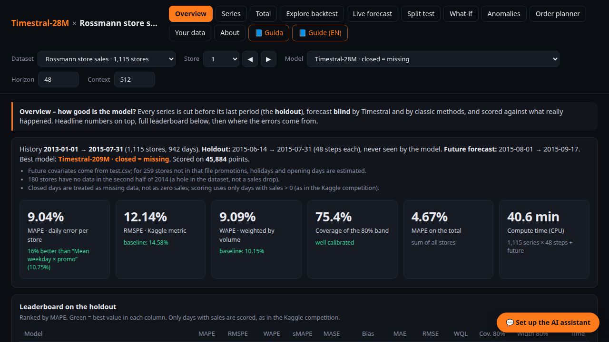
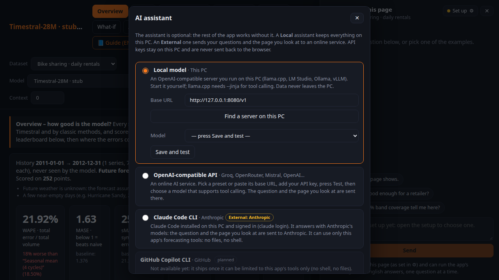

# J-Forecast Board

A local workbench to test time-series forecasting on public data and on your own, powered by
**Timestral**, the open time-series foundation model by Mistral AI. It runs on a normal office PC,
Windows or Linux, with no GPU.



> **What it is, and is not.** An independent, unofficial project, not affiliated with, endorsed by
> or supported by Mistral AI. A tool that runs on your PC, not an online service.

> [!IMPORTANT]
> **Licence of the model weights.** This app is Apache-2.0. The Timestral **weights** are under
> Mistral's "Modified MIT" licence: free, **except for companies (and their employees) with
> consolidated revenue above 20 M$ per month**, which need a commercial licence from Mistral. The
> weights are not part of this repository: the app downloads them from Hugging Face the first time
> you run a real forecast. Without them you can still try everything with the stub model (see below).

## Features

| Tab | What you get |
|---|---|
| **Overview** | Blind backtest of every series vs classic methods: headline numbers, leaderboard, error by step, weekday and group, calibration, best and worst series. |
| **Series** | One series: history, holdout forecasts, future forecast with 80% and 90% bands, covariates. |
| **Total** | The sum of all series: bottom-up vs forecasting the total directly. |
| **Explore backtest** | Move "today" through history and watch the forecast adapt. |
| **Live forecast** | Forecast from any date, any horizon, on the spot. |
| **Split test** | Give the model part of the history (e.g. 2 of 5 years) and compare the rest, period by period. |
| **What-if** | Edit future covariates (promotions, opening days, weather) and see the effect. |
| **Anomalies** | Points outside the model's uncertainty band. |
| **Order planner** | From quantiles to how much to stock: lost sales vs leftovers, against a classic "forecast + safety buffer". |
| **Your data** | Load a CSV with one or many series. It stays on your PC. |
| **💬 Ask about this page** | Optional AI assistant that explains what you see and runs the forecasting tools. Off until you set it up. |

Six public datasets are built in: Rossmann store sales (1,115 stores), bike sharing, an electricity
transformer, airline passengers, German electricity demand, Melbourne temperatures.

## Requirements

- Windows 10 or 11, or Linux (macOS should work, not tested)
- **Python 3.12, 3.13 or 3.14**
- About 3 GB of disk (packages ~1.2 GB, datasets ~40 MB, weights ~111 MB for the 28M model)
- Internet for the first setup (or see [offline PCs](docs/deployment.md#offline-pcs)); no GPU

## First run on Windows, step by step

1. **Get the code.** On GitHub press **Code → Download ZIP** and extract it, for example to
   `C:\j-forecast-board`. Or with git: `git clone https://github.com/janlu89/j-forecast-board.git`.
   Avoid a folder synchronised by OneDrive: setup creates about 1.2 GB of files.
2. **Install Python** if you do not have it. Check in PowerShell with `py --version`. If it is
   missing or older than 3.12, install Python 3.13 from
   [python.org](https://www.python.org/downloads/windows/) and tick **"Add python.exe to PATH"**,
   or run `winget install Python.Python.3.13`. Then open a new PowerShell window.
3. **Run the setup.** In the project folder, double-click **`setup.cmd`**. It creates a `.venv`
   folder, installs the pinned packages (about 1 GB, 5 to 15 minutes) and checks the PC. The first
   time it also downloads the public datasets.
4. **Read the result.** At the end you see a summary like `ok 58, warnings 1, failures 0` and a
   line `First sign-in: user 'admin', password '…'`. Note the password. The full report is in
   `diagnostics\doctor-report.txt`. One warning is normal: the model weights are not downloaded yet.
5. **Start the board.** Double-click **`start.cmd`**, or in PowerShell in the project folder:
   `.\start.cmd -Model stub` to try it without downloading the weights. Keep the window open.
   If port 8000 is busy: `.\start.cmd -Port 8010`.
6. **Open** <http://localhost:8000/> in your browser and sign in as `admin` with that password.
7. **First evaluation.** The board backtests the built-in datasets in the background; a pill at the
   top right shows the minutes left. The small datasets are ready in seconds; Rossmann takes a few
   minutes with the real 28M model (about 40 minutes for the 209M size on a 4-core PC). Results are
   cached: the next start is instant.

To stop the board, press **Ctrl+C** in its window or close it.

If PowerShell says that scripts are disabled, use the `.cmd` files as above: they run the scripts
for this time only, without changing any setting.

## First run on Linux, step by step

1. **Get the code**: `git clone https://github.com/janlu89/j-forecast-board.git && cd j-forecast-board`
2. **Python**: `python3 --version` must say 3.12 or newer. On Debian or Ubuntu:
   `sudo apt install python3.12 python3.12-venv` if needed.
3. **Setup**: `./setup.sh` (to pick a specific interpreter: `JFB_PYTHON=/usr/bin/python3.13 ./setup.sh`).
4. **Read the result** as in step 4 for Windows; the report is in `diagnostics/doctor-report.txt`.
5. **Start**: `./start.sh` (or `JFB_MODEL=stub ./start.sh`, or `./start.sh --port 8010`).
6. **Open** <http://localhost:8000/> and sign in as `admin`.

Forgot the password? `python -m j_forecast_board password` sets a new one (inside the `.venv`:
`.venv/bin/python -m …`, on Windows `.venv\Scripts\python -m …`).

## The stub model

`start.cmd -Model stub` (Windows) or `JFB_MODEL=stub ./start.sh` (Linux) runs the board with a
deterministic stand-in for Timestral. It downloads nothing and every screen works, but its numbers
are a simple seasonal rule, **not forecasts**: every model name then ends in "· stub". Use it to
check an installation or to try the board before deciding about the weights.

## Using your own data

In **Your data**, load a CSV exported from Excel or any tool (`,` or `;`, European decimals are
fine). It needs a date column and at least one numeric column. One file can hold many series: one
row per series and date, with a column that identifies the series (store, product, region…). Add
future rows with the target empty and planned values filled in (promotions, opening days) to give
the model known future covariates. Try it with the made-up sample `examples/sample_store_sales.csv`.

Your data is kept in the app's memory only, is never written to disk, and is **never sent to an
external AI assistant**. **Delete this dataset** removes it at once.

## The AI assistant



The assistant is **off** until you set it up, and the board works fully without it. Press
**💬 Set up the AI assistant**, bottom right, then choose one:

| Assistant | Where your question goes | What you need |
|---|---|---|
| **Local model** | stays on this PC (green **Local** badge) | an OpenAI-compatible server you run yourself: [llama.cpp](https://github.com/ggml-org/llama.cpp) (`llama-server --jinja …`), [Ollama](https://ollama.com), [LM Studio](https://lmstudio.ai). **Find a server on this PC** looks on the usual ports. Pick a model that supports tool calling. |
| **OpenAI-compatible API** | to that service (amber **External** badge) | a base URL and an API key. Presets: Groq, OpenRouter, Mistral, OpenAI. Pick a model that supports tool calling (for Groq: `openai/gpt-oss-120b`). |
| **Claude Code CLI** | to Anthropic (External) | [Claude Code](https://claude.com/claude-code) installed and signed in (`claude login`). It runs with no shell and no file access: only this app's forecasting tools. |
| **GitHub Copilot CLI** | planned | not available yet: it ships once it can be limited to this app's tools only (ADR-0008). |

Press **Save and test**, choose the model if asked, then **Use this assistant**.

**Before data leaves your PC** the board shows who will receive it and what: your question, the
visible text and numbers of the current tab, compact chart data, and the results of the tools the
assistant calls. Nothing is sent until you tick the box and confirm, and a new destination asks
again. You can also choose to send less: only the visible text, or only your question. Your
uploaded datasets are never sent to an external assistant. Check your company's rules before using
company data with an online service. Every call is written to the audit log, without its content
(see [data protection](docs/data-protection.md)).

### Setting up the assistant from a terminal

For people who work in a terminal, the same setup, with the same rules:

```
python -m j_forecast_board agent list
python -m j_forecast_board agent set local --base-url http://127.0.0.1:8080/v1 --model my-model
python -m j_forecast_board agent test local
python -m j_forecast_board agent use local

# an online API: the key is read from JFB_AGENT_API_KEY or asked for, never passed as an argument
python -m j_forecast_board agent set api --base-url https://api.groq.com/openai/v1 --model openai/gpt-oss-120b --key
python -m j_forecast_board agent test api
python -m j_forecast_board agent use api --accept-data-egress

# the Claude Code CLI (after `claude login`)
python -m j_forecast_board agent set claude-cli --model sonnet
python -m j_forecast_board agent test claude-cli
python -m j_forecast_board agent use claude-cli --accept-data-egress

python -m j_forecast_board agent off        # switch the assistant off
python -m j_forecast_board agent clear api  # forget its settings and key
```

Run them with the project's Python: `.venv\Scripts\python -m …` on Windows, `.venv/bin/python -m …`
on Linux, or activate the `.venv` first.

### For GitHub Copilot users

The Copilot CLI agent is planned and not shipped yet. Until then you can use any OpenAI-compatible
service your company approves, or a local model. If you have a Copilot licence and want to help
test it, see `docs/adr/0008-cli-assistants-and-copilot.md`.

## Configuration

Everything works without configuration. Settings are environment variables starting with `JFB_`:

| Variable | Default | Meaning |
|---|---|---|
| `JFB_PORT` / `JFB_HOST` | `8000` / `127.0.0.1` | where the board listens (this PC only by default) |
| `JFB_MODEL` | `timestral` | `stub` for the stand-in model |
| `JFB_DEFAULT_MODEL_SIZE` | `28M` | `5M`, `28M`, `123M` or `209M` |
| `JFB_OFFLINE` | `0` | `1` = never download anything |
| `JFB_HOME` | per-user folder | where runtime files live |
| `JFB_AUTH` | `on` | `off` only on this PC |

The full list, the runtime folder and the **admin policy file** (to forbid external assistants,
allow only some services, or force offline mode) are in [docs/configuration.md](docs/configuration.md).

- **Behind a corporate proxy**: set `HTTPS_PROXY` (and `PIP_CERT` / `SSL_CERT_FILE` if your network
  inspects HTTPS) before running the setup. The doctor report tells you which hosts are reachable.
- **Offline PCs**, **start at logon**, **sharing with colleagues** through a reverse proxy or
  Tailscale: see [docs/deployment.md](docs/deployment.md).

## Troubleshooting

| Problem | What to do |
|---|---|
| "Python 3.12, 3.13 or 3.14 is needed" | install it (step 2), open a new terminal, run the setup again |
| PowerShell: "running scripts is disabled" | use `setup.cmd` / `start.cmd`, or `powershell -ExecutionPolicy Bypass -File .\setup.ps1` |
| pip fails with SSL or certificate errors | your network inspects HTTPS: ask IT for the root certificate, set `PIP_CERT` and `SSL_CERT_FILE` to it; details in `diagnostics/pip.log` |
| downloads time out | set `HTTPS_PROXY` to your company proxy, or install offline |
| "port 8000 is in use" | start with another port: `start.cmd -Port 8010`, `./start.sh --port 8010` |
| datasets "not loaded" | their host was not reachable: see the network section of the doctor report |
| Hugging Face unreachable | use the stub model, or copy the weights from another PC (offline install) |
| the assistant button says "Set up" | no assistant is set up yet: that is the default |
| the Claude CLI is "not found" | install Claude Code and make sure `claude --version` works in a new terminal |

Run `python -m j_forecast_board doctor --no-model` at any time for a fresh report; it contains no
user name, no password and no values of your environment variables.

## Architecture and tests

Clean Architecture: `domain` (forecasting rules) ← `application` (use cases and ports) ←
`adapters` (web, model, datasets, storage, AI agents) ← `bootstrap` (wiring, CLI). The dependency
rule is checked by `lint-imports`. See [docs/architecture.md](docs/architecture.md) and the decision
records in [docs/adr](docs/adr).

```
pip install -e ".[dev]"
ruff check . && lint-imports && pytest -m "not model" && node --test "tests/js/*.test.mjs"
```

The golden tests pin every number the views return; `pytest -m model` also runs real forecasts with
Timestral-28M from your Hugging Face cache.

## Credits

- **Mistral AI** for Timestral: [announcement](https://mistral.ai/news/timestral/),
  [code](https://github.com/mistralai/timestral), models on Hugging Face
  ([5M](https://huggingface.co/mistralai/Timestral-5M), [28M](https://huggingface.co/mistralai/Timestral-28M),
  [123M](https://huggingface.co/mistralai/Timestral-123M), [209M](https://huggingface.co/mistralai/Timestral-209M)),
  [documentation](https://docs.mistral.ai/models/timestral-1-0-123m).
- Thanks to [Simone Rizzo (@simone-rizzo)](https://github.com/simone-rizzo) for sharing the idea that sparked this
  project. He is not involved in it and has not reviewed or endorsed it.
- [Plotly.js](https://plotly.com/javascript/) (MIT) for the charts.
- The public datasets and their authors: Kaggle "Rossmann Store Sales", UCI Bike Sharing (Fanaee-T
  and Gama, CC BY 4.0), ETDataset (Zhou et al., CC BY-ND 4.0), Box & Jenkins airline passengers,
  Open Power System Data, Australian Bureau of Meteorology. Details in
  [THIRD_PARTY_LICENSES.md](THIRD_PARTY_LICENSES.md).
- Built with [Claude Code](https://claude.com/claude-code).

## How to credit this project

If you use J-Forecast Board or build on it, please keep the `NOTICE` file and credit
"J-Forecast Board by Gianluca Meola" with a link to this repository. GitHub's **Cite this
repository** button gives a ready citation (from `CITATION.cff`).

## Licence, security, contributing

- Licence: [Apache License 2.0](LICENSE), Copyright 2026 Gianluca Meola. See [NOTICE](NOTICE).
- Security: please report vulnerabilities privately, see [SECURITY.md](SECURITY.md).
- Contributing: see [CONTRIBUTING.md](CONTRIBUTING.md) and the [code of conduct](CODE_OF_CONDUCT.md). Changes: [CHANGELOG.md](CHANGELOG.md).
